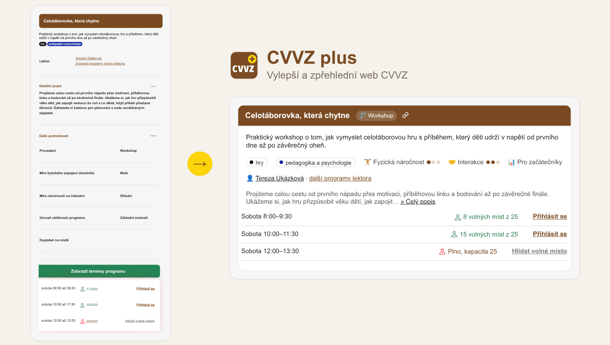

# CVVZ plus

Neoficiální rozšíření pro prohlížeče Firefox a Chrome, které zlepší zpřehlední web [akce CVVZ](https://www.cvvz.cz/) (Celostátní vzájemná výměna zkušeností),
zlepší jeho použitelnost, UX a přidá některé nové funkce.



Mimo jiné udělá kompaktnější a přehlednější stránku Program. Jednotlivé funkce jde v nastavení rozšíření samostatně vypnout.

Funguje ve Firefoxu (i na Androidu) a v prohlížečích postavených na Chromiu (Chrome, Edge, Brave, Opera...).

## Technická implementace

### Co rozšíření dělá

Rozšíření je uděláno modulárně a rozšířitelně. 

Každá úprava je samostatný modul ve složce stránky, kterou mění: `extension/src/<stránka>/features/`.
Každý modul obsahuje své styly a testy.
Každý modul jde vypnout v nastavení rozšíření.

**Celý web** (`site`, všechny stránky www.cvvz.cz):

| Modul         | Popis                                                                          |
|---------------|--------------------------------------------------------------------------------|
| `logo-plus`   | Přidat ikonku ➕ k logu v záhlaví webu (jako znamení, že je rozšíření zapnuto) |
| `back-to-top` | Přidat na mobilu tlačítko pro odscrollování zpět nahoru                        |

**Stránka Program** (`program`, https://www.cvvz.cz/program):

| Modul           | Popis                                                                                           |
|-----------------|-------------------------------------------------------------------------------------------------|
| `program-card`  | Zobrazit každý program v ohraničené kartě (pro lepší vizuální přehlednost)                      |
| `program-type`  | Zobrazit typ programu (provedení) jako štítek s emoji v záhlaví programu                        |
| `labels`        | Zobrazit parametry programu jako štítky (a ne ve schované tabulce)                              |
| `lecturer`      | Odkaz na další programy lektora je na jednom řádku za jménem lektora                            |
| `terms`         | Zobrazit termíny přímo jako seznam u programu (místo rozbalovacího menu schovaného po kliknutí) |
| `term-capacity` | Upravit zobrazení volných míst a kapacity na srozumitelnější                                    |
| `description`   | Detailní popis má rovnou zobrazený úryvek, zbytek po kliknutí                                   |
| `permalink`     | Po najetí myší zobrazit ikonu 🔗, která zkopíruje odkaz na program pro snazší sdílení           |
| `program-count` | Zobrazit u nadpisu celkový počet vypsaných programů                                             |
| `filter-form`   | Odsadit filtr od seznamu programů pro lepší přehlednost                                         |

**Stránka Přihlášení účastníci** (`participants`, https://www.cvvz.cz/prihlaseni-ucastnici):

| Modul           | Popis                                                                                         |
|-----------------|-----------------------------------------------------------------------------------------------|
| `stats`         | Přidá podstránku Statistiky účastníků do záložky vedle seznamu účastníků, přidá odkaz do menu |
| `compact-table` | Kompaktnější tabulka seznamu účastníků (nižší řádky, upravené šířky sloupců aj.)              |
| `contacts`      | Zobrazit FB, telefon a e-mail v jednom sloupci jako ikonky                                    |

## Struktura

```
extension/
  manifest.json                    manifest rozšíření (jeden pro všechny browsery)
  src/shared/features.js|css       registr modulů (registerFeature) a společné styly
  src/site/features/*.js|css       moduly pro všechny stránky webu
  src/program/parse.js             parser programů ze stránky do interního datového modelu
  src/program/layout.js            generátor základní kostry programu, na který jednotlivé moduly přidávají úpravy
  src/program/program-list.js      pro každý program postaví nový vzhled ze všech modulů a vymění ho za původní
  src/program/features/*.js|css    moduly stránky Program
  src/participants/table.js        tabulka účastníků
  src/participants/features/*.js|css  moduly stránky Přihlášení účastníci
  src/main.js                      entrypoint, spustí zapnuté moduly stránek, ke kterým patří aktuální URL (viz registr `PAGES`)
  options/options.html|js|css      nastavení rozšíření: přepínač pro každý modul
test/                              testy (Node.js + jsdom), kopírující strukturu modulů
test/fixtures/                     uložené snapshoty stránek, které používají testy
```

Každý modul má v `page` uvedenou svou stránku. `main.js` pak podle URL spustí jen moduly aktuální stránky. Modul `site` se pustí vždy.

### Stránka Program - theory of operation

1. `parse.js` projde stránku a z každého programu udělá interní datový objekt `program` (název, perex, štítky, lektoři, popis, parametry, počet termínů).
   Pokud parser narazí na cokoliv nečekaného (nový řádek tabulky, nový prvek...), program přeskočí. Při nenadálé změně HTML webu CVVZ by se tak nemělo nic rozbít, ale fallbacknout na původní verzi.
2. `program-list.js` pro každý přečtený program vytvoří kostru (`createProgramLayout` z `layout.js`) a nechá postupně všechny moduly přidat své části (`renderProgram`).
3. Když všechny moduly úspěšně doběhnou, vloží se nový `<section>` před původní blok v HTML a původní prvky jen skryje (třída `cvvz-hidden`).
   Skryjí se jen řádky polí, které zobrazuje kostra nebo některý zapnutý modul (viz `shows`). Části vypnutých modulů zůstanou tak, jak je ukazuje web, přesunuté do `<section>`.
4. Program, kterému parser nebo některý modul nerozumí, zůstane tak, jak ho vykreslil web v původním HTML. Do konzole browseru se pak vypíše důvod jako varování.

Moduly běží v pořadí podle `manifest.json` a v tom pořadí se také zobrazují jejich části.

### Stránka Přihlášení účastníci

Moduly upravují přímo tabulku webu (`enhancePage`). Buňky skrývají (třída `cvvz-hidden`), přesouvají nebo mění jejich obsah.
Pokud web změní v HTML sloupce tabulky, moduly ji nechají v původní podobě a do konzole se vypíše varování.

Modul `stats` počítá statistiky z řádků tabulky, takže při filtru (město, organizace) jsou to statistiky vyfiltrovaných účastníků.
Tabulku čte dřív, než ji ostatní moduly změní, proto musí být v `manifest.json` první.

### Přidání nové úpravy

1. Vytvořit `extension/src/<stránka>/features/nazev.js`, např. `extension/src/program/features/nazev.js`:
   ```js
   registerFeature({
       page: 'program',
       name: 'nazev',
       label: 'Popis funkce, který se zobrazuje v nastavení rozšíření (česky).',
       shows: ['description'], // pro stránku Program: pole programu, která modul zobrazuje (jejich původní řádky se skryjí)
       renderProgram(program, layout, original) {
           // pro stránku Program: přidá prvky do layout.header nebo layout.section, na základě dat z `program`
       },
       enhancePage(document) {
           // volitelné: pro úpravy celé stránky (na stránce Program se spustí jednou po všech programech)
       },
       enhanceSite(document) {
           // volitelné: spustí se na všech stránkách webu, pro části modulu mimo jeho stránku (např. odkaz na něj v menu)
       },
   });
   ```
   * `page` musí odpovídat složce (`site` pro všechny stránky, `name` názvu souboru.
   * Pomocná funkce `buildElement(tag, class, text)` vytvoří prvek (nepoužívat `innerHTML`).
   * Původní HTML prvek stránky nepřestavovat, ale přesunout přes `layout.moveOriginal(element, target)`.
2. Pokud má feature nějaký styl, přidat do `extension/src/<stránka>/features/nazev.css`.
3. Oba soubory přidat do `manifest.json` a skript i do `extension/options/options.html` (kvůli přepínači v nastavení rozšíření).
4. Přidat test (`test/<stránka>/features/nazev.test.js`).

Pro novou stránku webu: založit složku `extension/src/<stránka>/features/`, přidat stránku s podmínkou na URL do `PAGES` v `src/main.js`
a její název do `OPTIONS_PAGE_TITLES` v `extension/options/options.js`.

Základní test `test/main.test.js` hlídá, že každý modul je v manifestu, patří stránce své složky, má popis a test a že moduly běží jen na své stránce.
Test `test/program/program-list.test.js` hlídá, že všechny moduly dohromady zobrazí všechny informace z původní stránky programu.

## Development

Node.js (24 LTS) a Firefox.

```sh
npm install
npm start
```

* `npm start` spustí čistý temporary profil Firefoxu a po každém uložení souboru rozšíření sám znovu načte.

Pro otestování ve vlastním profilu ve Firefoxu: 
* `about:debugging#/runtime/this-firefox` → **Načíst dočasný doplněk...** → vybrat `extension/manifest.json`.
* Rozšíření vydrží jen do restartu prohlížeče, po změně je třeba dát **Znovu načíst**.

### Chrome, Edge a další Chromium prohlížeče

* `chrome://extensions` → zapnout **Režim pro vývojáře** → **Načíst rozbalené** → vybrat složku `extension/`.
* Upozornění na neznámý klíč `browser_specific_settings` možno je očekávano a možno ignorovat (je specifické pro Firefox)

### Firefox pro Android

1. V androidu zapnout vývojářské možnosti a v nich **Ladění přes USB**.
2. Ve Firefoxu pro Android: Nastavení → **Vzdálené ladění přes USB**.
3. Připojit telefon kabelem, ověřit přes `adb devices`.
4. `npm run start:android -- --android-device <id-z-adb> --firefox-apk org.mozilla.firefox`

Rozšíření běží, dokud není příkaz ukončený neukončíte. Chrome na Androidu rozšíření nepodporuje, což je smutný příběh,
ale stěžuje si u Googlu a použijte Firefox.

## Testy

```sh
npm test            # testy nad uloženými stránkami v test/fixtures/
npm run test:live   # načte aktuální stránku z webu a ověří, že s ní rozšíření stále funguke
npm run lint        # kontrola rozšíření validátorem addons.mozilla.org
```

* `test:live` pouštět pokud se zdá, že se web změnil. Když selže, vypíše, které programy a proč rozšíření nepoznalo. Pak je třeba
  1. Uložit aktuální stránku jako novou fixture: `curl -o test/fixtures/program-RRRR-MM.html https://www.cvvz.cz/program`
  2. Upravit `src/program/parse.js` (případně modul) a přidat test nad novou fixture.
* Stránka Přihlášení účastníci obsahuje osobní údaje, do repozitáře se proto nesmí uložit tak, jak je.
  Fixture se vytvoří skriptem, který stáhne aktuální stránku a skutečné účastníky nahradí vymyšlenými:
  `node test/make-participants-fixture.js > test/fixtures/participants-RRRR-MM.html`
